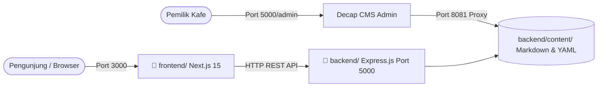

# ☕ Kopi Senja — Official Web & REST API

> **Landing page resmi & backend digital menu untuk coffee shop modern berbasis arsitektur client-server monorepo.**  
> Dibangun dengan **Next.js 15 (React 19)**, **Express.js (TypeScript)**, **Tailwind CSS v4**, dan **Decap CMS 3**.

---

## 📌 Daftar Isi
- [Tentang Proyek](#-tentang-proyek)
- [Arsitektur Proyek](#-arsitektur-proyek)
- [Fitur Utama](#-fitur-utama)
- [Struktur Direktori](#-struktur-direktori)
- [Panduan Memulai (Getting Started)](#-panduan-memulai-getting-started)
- [Dokumentasi REST API](#-dokumentasi-rest-api)
- [Panduan Decap CMS (Admin Panel)](#-panduan-decap-cms-admin-panel)
- [Daftar Perintah (NPM Scripts)](#-daftar-perintah-npm-scripts)
- [Pengujian Otomatis](#-pengujian-otomatis)
- [Lisensi](#-lisensi)

---

## 📖 Tentang Proyek

**Kopi Senja** dirancang sebagai wajah digital coffee shop yang dioptimalkan untuk **mobile-first** bagi pengunjung (khususnya pelajar & mahasiswa). Situs ini menyediakan:
- **Menu Digital & Harga Real-Time:** Mudah dibaca, memiliki pencarian instan, filter kategori, dan varian rasa/ukuran.
- **Galeri Suasana Kafe:** Menampilkan spot instagramable (*Sudut Favorit*) dan area kerja komunal dengan colokan & WiFi.
- **Informasi Operasional Real-Time:** Status buka/tutup toko otomatis berdasarkan zona waktu Indonesia Barat (**WIB / UTC+7**).
- **Banner Promo & Event:** Menyorot promo potongan harga pelajar dan agenda kegiatan live music akustik.
- **Admin CMS Tanpa Koding:** Pemilik kafe dapat mengelola seluruh menu, galeri, promo, dan jam operasional lewat antarmuka visual **Decap CMS** secara lokal tanpa biaya server.

---

## 🏗️ Arsitektur Proyek

Proyek ini menggunakan struktur **Monorepo (NPM Workspaces)** yang memisahkan aplikasi ke dalam dua folder mandiri:



1. **`backend/` (Port 5000):**
   - Server REST API berbasis **Express.js & TypeScript**.
   - Melayani endpoint data berformat JSON (`/api/menu`, `/api/kategori`, `/api/galeri`, `/api/promo`, `/api/info-toko`, `/api/status-toko`).
   - Menyimpan dan membaca berkas konten terstruktur Markdown & YAML di `backend/content/`.
   - Menyajikan panel admin **Decap CMS** di `/admin`.
2. **`frontend/` (Port 3000):**
   - Aplikasi modern berbasis **Next.js 15 (App Router)** & **React 19**.
   - Desain responsif bergaya estetik kafe dengan **Tailwind CSS v4** dan **shadcn/ui**.
   - Mengambil data melalui modul API Client di `src/lib/api.ts` dengan *fallback* statis.

---

## ✨ Fitur Utama

Sesuai dokumen spesifikasi kebutuhan ([`kopi-senja-PRD.md`](./kopi-senja-PRD.md)):

### ☕ Fase 1 — Menu Digital
- **Daftar Menu Realistis (16 Menu):** Kategori Kopi (Es Kopi Susu Senja, Americano, Caramel Macchiato, Cafe Latte, Cold Brew Gayo 16 Jam, Manual Brew V60), Non-Kopi (Matcha Latte, Artisan Earl Grey, Dark Chocolate, Red Velvet, Berry Lemonade), dan Camilan (Croissant Butter, Pain au Chocolat, Roti Bakar Cokelat Keju, Kentang Truffle, Cireng Rujak).
- **Pencarian Cepat:** Pencarian instan berdasarkan nama, kategori, atau deskripsi menu (`?q=...`).
- **Filter & Sorting:** Filter per kategori dan pengurutan harga termurah/termahal (`?sort=harga_asc`).
- **Detail Menu & Rekomendasi:** Informasi foto, opsi ukuran, varian rasa, harga terformat Rupiah, dan 3 menu terkait (*related items*).

### 🌿 Fase 2 — Galeri Suasana & Info Kunjungan
- **Spot Suasana Kafe:** Menampilkan foto area kafe (Outdoor Garden, Coffee Bar, Meja Komunal Colokan, Sudut Jendela).
- **Penanda Sudut Favorit:** Menyorot spot foto paling instagramable.
- **Kalkulasi Status Jam Buka:** Menampilkan status terkini (*"Buka • Tutup pukul 23:00"* atau *"Tutup • Buka besok pukul 09:00"*) sesuai waktu lokal WIB.
- **Peta & Kontak:** Tautan Google Maps, iframe embed peta, dan tautan profil Instagram resmi kafe.

### 🎉 Fase 3 — Sorotan & Promosi
- **Banner Promo:** Menyorot diskon Happy Hour dan Paket Nongkrong Pelajar Rp 25.000.
- **Agenda Kegiatan:** Info jadwal acara musik live (*Acoustic Night: Senja Berdendang* setiap Sabtu malam).
- **Badge Menu Rekomendasi:** Penanda khusus untuk menu andalan kafe.

---

## 📂 Struktur Direktori

```text
Kontrakan-Coffee-Web/
├── backend/                        # ☕ REST API Server & Data Layer
│   ├── content/                    # Sumber data konten terstruktur
│   │   ├── menu/                   # 16 Berkas markdown menu item
│   │   ├── kategori/               # Berkas konfigurasi YAML kategori
│   │   ├── galeri/                 # Berkas markdown galeri foto suasana
│   │   ├── promo/                  # Berkas markdown promo & kegiatan
│   │   └── info-toko.json          # Profil toko, alamat, peta, dan jam buka
│   ├── public/
│   │   ├── admin/                  # Decap CMS (index.html & config.yml)
│   │   └── images/                 # Berkas gambar & placeholder SVG
│   ├── scripts/
│   │   └── test-backend.mjs        # Skrip uji otomatis integritas data (102 test)
│   ├── src/
│   │   ├── index.ts                # Express server entry point, CORS, static server
│   │   ├── routes/
│   │   │   └── api.ts              # Express Router REST API endpoints
│   │   └── lib/
│   │       ├── content.ts          # Content loader, business logic jam buka WIB
│   │       └── types.ts            # Definisi tipe TypeScript backend
│   ├── package.json
│   └── tsconfig.json
│
├── frontend/                       # 🌐 Next.js 15 Client Web Application
│   ├── public/                     # Aset publik frontend & logo
│   ├── src/
│   │   ├── app/                    # Next.js App Router (layout.tsx, page.tsx, globals.css)
│   │   ├── components/             # Komponen UI (shadcn/ui & komponen kafe)
│   │   └── lib/
│   │       ├── api.ts              # API Client pemanggil REST API backend
│   │       ├── content.ts          # Fallback loader saat build offline
│   │       ├── types.ts            # Tipe data TypeScript frontend
│   │       └── utils.ts            # Helper styling (cn, clsx)
│   ├── next.config.ts
│   ├── tsconfig.json
│   ├── components.json
│   └── package.json
│
├── package.json                    # 📦 Root Workspaces configuration
├── package-lock.json
├── netlify.toml                    # Konfigurasi deployment Netlify
├── kopi-senja-PRD.md               # Dokumen spesifikasi kebutuhan proyek (PRD)
├── SETUP.md                        # Panduan inisialisasi & setup
└── README.md                       # Dokumentasi utama proyek
```

---

## 🚀 Panduan Memulai (Getting Started)

### Prasyarat
- **Node.js**: Versi `20.9` ke atas (Direkomendasikan **Node.js 22 LTS**).
- **NPM**: Versi `10.x` ke atas.

### 1. Instalasi Dependensi
Cukup jalankan satu perintah dari folder root untuk menginstal seluruh dependensi backend dan frontend:
```bash
npm install
```

### 2. Menjalankan Server Pengembangan

#### Opsi A: Menjalankan Backend & Frontend Bersamaan
```bash
npm run dev
```

#### Opsi B: Menjalankan Secara Terpisah (Direkomendasikan untuk Debugging)
Buka terminal terpisah:
```bash
# Terminal 1 — Backend REST API (Port 5000)
npm run dev:backend

# Terminal 2 — Frontend Next.js (Port 3000)
npm run dev:frontend

# Terminal 3 (Opsional) — Decap CMS Local Proxy (Port 8081)
npm run cms
```

Akses layanan di peramban Anda:
- **Web Frontend:** [http://localhost:3000](http://localhost:3000)
- **Backend API:** [http://localhost:5000/api](http://localhost:5000/api)
- **Admin CMS:** [http://localhost:5000/admin/index.html](http://localhost:5000/admin/index.html)

---

## 📡 Dokumentasi REST API

Semua endpoint menyajikan respon JSON dengan header `Content-Type: application/json` dan mendukung CORS.

| Metode | Endpoint | Parameter Query | Deskripsi |
|---|---|---|---|
| `GET` | `/api` | - | Overview & dokumentasi endpoint yang tersedia |
| `GET` | `/api/health` | - | Health check server status |
| `GET` | `/api/kategori` | - | Mengambil semua kategori menu terurut |
| `GET` | `/api/menu` | `?q=`, `?kategori=`, `?rekomendasi=`, `?sort=` | Mengambil daftar menu aktif dengan opsi pencarian & filter |
| `GET` | `/api/menu/rekomendasi`| - | Mengambil menu andalan / rekomendasi kafe |
| `GET` | `/api/menu/:slug` | - | Mengambil detail 1 menu beserta 3 menu serupa (*relatedMenu*) |
| `GET` | `/api/menu/slugs` | - | Mengambil daftar seluruh slug untuk static build |
| `GET` | `/api/galeri` | `?favorit=true` | Mengambil foto suasana kafe (opsional filter sudut favorit) |
| `GET` | `/api/promo` | `?tipe=promo\|kegiatan`, `?aktif_saja=true` | Mengambil promo diskon atau jadwal kegiatan live music |
| `GET` | `/api/info-toko` | - | Mengambil profil toko, alamat lengkap, link & embed peta, Instagram, dan jam buka |
| `GET` | `/api/status-toko` | - | Menghitung status buka/tutup toko real-time WIB (UTC+7) |

### Contoh Pemanggilan API:
```bash
# Mencari menu dengan kata kunci "kopi"
curl -s "http://localhost:5000/api/menu?q=kopi"

# Mengurutkan menu dari yang termurah
curl -s "http://localhost:5000/api/menu?sort=harga_asc"

# Mengecek status operasional kafe saat ini
curl -s "http://localhost:5000/api/status-toko"
```

---

## 🎛️ Panduan Decap CMS (Admin Panel)

Decap CMS memungkinkan staf atau pemilik kafe memperbarui menu, foto, dan jam buka tanpa menyentuh kode.

### Pengujian Lokal (Tanpa Akun Netlify)
1. Pastikan backend server menyala (`npm run dev:backend`).
2. Jalankan proxy Decap di terminal terpisah:
   ```bash
   npm run cms
   ```
3. Buka browser ke **`http://localhost:5000/admin/index.html`**.
4. Klik tombol **"Login"** (otomatis masuk ke local git mode tanpa meminta kata sandi atau akun Netlify).
5. Edit konten atau tambah menu baru, lalu klik **Save**. Perubahan langsung tersimpan ke berkas di `backend/content/` dan langsung ter-update di REST API!

---

## 🛠️ Daftar Perintah (NPM Scripts)

Dijalankan dari direktori root proyek:

| Perintah | Deskripsi |
|---|---|
| `npm run dev` | Menjalankan backend dan frontend secara bersamaan |
| `npm run dev:backend` | Menjalankan server Express backend di port `5000` dengan *hot reload* |
| `npm run dev:frontend` | Menjalankan server Next.js frontend di port `3000` |
| `npm run cms` | Menjalankan proxy lokal `decap-server` di port `8081` untuk admin CMS |
| `npm run build` | Melakukan build kompilasi TypeScript untuk backend dan static export untuk frontend |
| `npm run build:backend` | Mengompilasi kode TypeScript backend ke `backend/dist/` |
| `npm run build:frontend` | Melakukan build Next.js frontend |
| `npm run test` / `npm run test:backend` | Menjalankan uji otomatis integritas konten dan kalkulasi jam buka |
| `npm run lint:frontend` | Memeriksa kepatuhan kode frontend dengan ESLint |

---

## 🧪 Pengujian Otomatis

Proyek ini dilengkapi dengan skrip verifikasi otomatis yang menguji **102 aspek** kualitas data dan business logic:
- Integritas berkas kategori, menu, galeri, dan promo.
- Validasi harga positif dan cerita rasa pada setiap menu.
- Verifikasi logika jam operasional kafe di zona waktu WIB (simulasi buka dan tutup).
- Validasi berkas konfigurasi Decap CMS.

Jalankan test dengan perintah:
```bash
npm run test:backend
```

Output:
```text
=================================================
HASIL TEST: 102 / 102 pengujian BERHASIL.
🎉 SEMUA PENGUJIAN REALISTIC DATA & BACKEND SUKSES!
```

---

## 📄 Lisensi

Proyek ini dikembangkan untuk keperluan web resmi **Kopi Senja**. Bebas dikembangkan dan dimodifikasi sesuai kebutuhan kafe.
