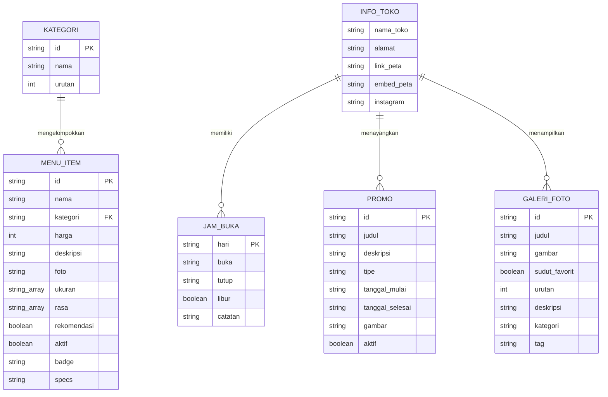

# PRD — Project Requirements Document (Improvised & Synchronized)

## ☕ Kontrakan Coffee — Spatial Atelier & Digital Menu Web Application

> **Status Dokumen:** Living PRD (Telah Diperbarui & Disinkronisasi Sesuai Implementasi Aktual Proyek)  
> **Versi:** 2.0.0 (Monorepo Client-Server & Advanced Editorial Frontend)  
> **Target Rilis:** Production-Ready Landing Page & Admin CMS  
> **Peran Penyusun:** Senior Frontend Developer & UI/UX Architect  

---

## 1. Overview & Latar Belakang

### 1.1 Latar Belakang Masalah
Banyak *artisan coffee shop* dan *creative spatial roastery* saat ini hanya mengandalkan media sosial (Instagram) atau papan tulis fisik untuk membagikan informasi menu dan operasional kafe. Pengunjung—terutama mahasiswa, pekerja kreatif (*remote workers / WFC*), dan penikmat kopi spesialti—sering kali mengalami kendala:
1. Kesulitan menemukan daftar menu lengkap dan harga resmi tanpa harus menggulir puluhan feed/story Instagram.
2. Tidak adanya kepastian mengenai jam buka kafe secara *real-time* (apakah kafe saat ini buka atau sudah tutup di zona waktu lokal).
3. Sulitnya mendapatkan gambaran visual ruangan kafe yang sesungguhnya (area meja komunal bercolokan listrik, Wi-Fi, dan area outdoor).
4. Pemilik kafe kesulitan memperbarui menu harian, promosi, dan jadwal operasional tanpa memerlukan bantuan tim teknis (*developer*).

### 1.2 Tujuan Utama Aplikasi
Membangun satu ekosistem web resmi **Kontrakan Coffee** yang berfungsi sebagai wajah *branding visual editorial*, katalog menu digital yang interaktif, dan panduan kunjungan fisik yang informatif:

- **Branding Visual Berkelas & Anti-Generic (Editorial Design System):** Menerapkan identitas visual yang khas, terbebas dari kesan *template/AI-generated*, memadukan palet warna *warm oat cream*, *roasted mocha*, *deep espresso*, dan aksen *latte taupe*, diperkaya dengan mikrointeraksi berbasis *WebGL (OGL)*, *GSAP*, dan *pinned scroll choreography*.
- **Menu Digital & Pencarian Cepat:** Menyajikan katalog menu lengkap beserta harga, filter kategori (*Kopi Atelier*, *Non-Kopi*, *Camilan & Pastry*, *Rekomendasi*), pengurutan harga/nama, dan kolom pencarian instan.
- **Informasi Operasional Real-Time (WIB):** Memiliki kalkulator status operasional kafe berbasis zona waktu Indonesia Barat (**WIB / UTC+7**) dengan indikator visual *beacon live* (*"BUKA SEKARANG"* / *"SEDANG TUTUP"*).
- **Galeri Suasana & Sudut Favorit:** Memperlihatkan spot *instagramable* dan ruang kerja dengan dukungan *lightbox modal* berfitur navigasi papan ketik (*keyboard shortcuts*).
- **Showcase Interaktif 3D (Circular Gallery):** Menampilkan menu rekomendasi kurasi dalam bentuk silinder 3D interaktif (*touch drag & wheel scroll*) dengan *photo frame template* modular yang siap menerima aset Decap CMS.
- **Kemandirian Pengelolaan Konten (Decap CMS):** Memungkinkan staf dan pemilik kafe memperbarui menu, jam buka, dan galeri melalui antarmuka visual tanpa koding, baik secara lokal (*LAN multi-device*) maupun di lingkungan *production* (*Git Gateway*).
- **Arsitektur Resilien (Dual-Mode Data Layer):** Frontend dapat berjalan secara dinamis mengambil data dari REST API backend Express.js, sekaligus memiliki *automatic graceful fallback* ke data lokal statis saat server backend tidak aktif atau saat di-deploy sebagai *static export*.

### 1.3 Batas Lingkup (Scope & Non-Goals)
- **Informational & Experiential:** Situs ini **bukan** e-commerce atau platform pemesanan online langsung. Tidak ada keranjang belanja (*cart*), proses pembayaran (*payment gateway*), maupun pengiriman pesanan.
- **Kanal Kontak:** Tautan WhatsApp dan Instagram murni berfungsi sebagai kanal komunikasi tanya-jawab, reservasi meja manual, atau konfirmasi ketersediaan menu.
- **Pemesanan Fisik:** Seluruh transaksi dan seduhan dilakukan langsung di meja kasir (*slow bar*) saat pengunjung tiba di lokasi fisik kafe.

### 1.4 Target Pengguna
1. **Pengunjung & Mahasiswa / WFC:** Mencari tempat singgah, belajar, atau bekerja dengan suasana tenang, colokan listrik memadai, dan menu yang transparan.
2. **Penikmat Kopi Spesialti:** Ingin mengetahui komposisi, profil rasa (*tasting notes*), dan formula seduhan manual (*manual brew*).
3. **Pemilik & Barista Kafe:** Mengelola inventaris menu aktif, menandai menu andalan, dan mengubah jam operasional mingguan secara instan lewat CMS.

---

## 2. Requirements Proyek

### 2.1 Persyaratan Fungsional (Functional Requirements)

| ID | Modul | Deskripsi Kebutuhan |
|---|---|---|
| **FR-01** | **Hero & Pinned Stage** | Menampilkan identitas Kontrakan Coffee dengan pementasan scroll terikat (*pinned choreography* 300svh), foto latar berskala dinamis, overline artistik, dan animasi pemunculan teks per-kata (*SplitWords*). |
| **FR-02** | **Manifesto Reveal** | Menampilkan kalimat pembuka filosofi atelier kafe melalui efek singkap gambar vertikal (*top-down wipe*) 320svh dengan tipografi *difference-blended*. |
| **FR-03** | **Katalog Menu Digital** | Menampilkan daftar menu dalam format *ruled table* editorial tanpa gambar invasif, mencakup nomor urut, nama, badge rekomendasi/spesial, kategori, varian ukuran, deskripsi rasa, formula komposisi, dan harga Rupiah terformat. |
| **FR-04** | **Filter & Pencarian Menu** | Pengunjung dapat menyaring menu berdasarkan kategori (*Semua*, *Kopi Atelier*, *Non-Kopi*, *Camilan*, *Andalan Kafe ★*), melakukan pencarian instan via teks (*query* nama, deskripsi, spesifikasi), dan mereset filter. |
| **FR-05** | **Pengurutan Menu (Sorting)** | Menyediakan opsi pengurutan menu: Rekomendasi Atelier (*default*), Harga Terendah (`price-asc`), Harga Tertinggi (`price-desc`), dan Nama Menu A-Z (`name-asc`). |
| **FR-06** | **Modal Detail Menu** | Mengetuk baris menu membuka modal kartu terfokus yang menyajikan: Kategori, Foto Menu (*PhotoFrameTemplate*), Nama Menu, Harga terformat Rupiah, Deskripsi Rasa/Bahan, serta Catatan Kunjungan informatif (penegasan non-pemesanan online, transaksi dilakukan di meja kasir). |
| **FR-07** | **Recommended 3D Wheel** | Menampilkan menu andalan dalam silinder 3D melengkung (*Circular Gallery*) berbasis WebGL/OGL yang dapat digeser (*drag/swipe/scroll*), responsif sentuhan ponsel, dan terhubung ke modal detail. |
| **FR-08** | **Galeri Suasana Kafe** | Menampilkan foto ruang kafe dengan filter kategori (*Semua*, *Sudut Favorit*, *Manual Bar*, *Komunal Kerja*, *Outdoor Garden*). |
| **FR-09** | **Full-Screen Lightbox** | Mengetuk foto galeri membuka tampilan layar penuh berlatar gelap dengan navigasi foto sebelumnya/berikutnya dan kontrol papan ketik (`Escape`, `ArrowLeft`, `ArrowRight`). |
| **FR-10** | **Jam Operasional Real-Time** | Menghitung status kafe secara langsung berdasarkan waktu WIB (UTC+7): menampilkan badge *beacon* berdenyut (*"BUKA SEKARANG"* / *"SEDANG TUTUP"*), teks status penutupan/pembukaan berikutnya, dan penanda khusus hari ini (*"HARI INI"*) pada tabel jadwal 7 hari. |
| **FR-11** | **Peta Interaktif & Navigasi** | Menyajikan iframe Google Maps responsif yang ditata dengan filter kontras/grayscale estetik, chip alamat, dan tombol navigasi langsung ke Google Maps. |
| **FR-12** | **Footer & Presensi Digital** | Menyajikan penutup halaman (*designed closing scene*) monumental 2-kolom: kanal media sosial resmi (Instagram, WhatsApp, Google Maps) di sisi kiri, serta alamat lengkap kafe dan kalimat hak cipta `© 2026 KONTRAKAN COFFEE` di sisi kanan desktop. |
| **FR-13** | **Navigasi Multi-Layered GSAP** | Header navigasi desktop yang menyusut saat di-scroll (*shrinkOnScroll*), dilengkapi menu hamparan penuh (*full-screen staggered overlay*) di ponsel dengan animasi lapis warna GSAP timeline. |
| **FR-14** | **Pengelolaan Konten Mandiri (CMS)**| Mengedit seluruh menu, kategori, foto galeri, promo, dan jam operasional via Decap CMS di `/admin` dengan dukungan alur kerja editorial (*draft-review-publish*). |
| **FR-15** | **REST API Server** | Backend Express.js melayani 11 endpoint JSON publik dengan dukungan CORS, parameter filter/sorting, dan dynamic host URL rewriting untuk akses LAN. |

### 2.2 Persyaratan Non-Fungsional (Non-Functional Requirements)

- **Mobile-First & Touch Ergonomics:** Seluruh komponen, mulai dari menu table, filter chips scrollable horizontal, 3D WebGL drag, hingga modal, dirancang untuk kenyamanan ketukan ibu jari pada layar ponsel (360px–430px) sebelum diperluas ke tablet dan desktop.
- **Design System & Anti-Slop Visual Taste:**
  - Menerapkan arsitektur token tiga lapis (*Primitive*, *Semantic*, *Component*).
  - Distribusi warna harmonis 60-30-10: 60% *Warm Oat Cream* (`#EEE6D7`), 30% *Roasted Mocha* (`#5F493C`), 10% aksen *Latte Taupe* (`#C7B8AE`) dan teks *Deep Espresso* (`#472F1D`).
  - Standar aksesibilitas kontras tinggi: Rasio kontras teks `#472F1D` di atas kanvas `#EEE6D7` mencapai **10.07:1** (memenuhi syarat **WCAG AAA**).
  - Finishing taktil: Hamparan butiran noise halus (*grain overlay*), tepi tajam modular (*sharp edges*), dan tipografi arsitektural (*Plus Jakarta Sans* & *Saira Extra Condensed*).
- **Performa & Animasi GPU-Accelerated:**
  - Animasi transform scroll menggunakan `will-change: transform`, `transform-style: preserve-3d`, serta fungsi *smootherstep* berbasis `requestAnimationFrame` untuk menjamin 60 FPS tanpa jank.
  - Renderer WebGL (OGL) diisolasi dengan penanganan error aman (*fallback canvas frame*) dan sanitasi aspek rasio shader anti-NaN (*zero divide-by-zero crashes*).
- **Reliabilitas & Dual-Mode Fallback:** Frontend tidak boleh rusak (*crash*) jika backend API mati atau jaringan lambat. Modul `clientApi.ts` mengimplementasikan timeout 3000ms–4000ms dengan *AbortController* dan secara transparan beralih ke data lokal berkualitas tinggi.
- **LAN Multi-Device Testing:** Mendukung pengujian langsung dari smartphone di jaringan Wi-Fi lokal melalui auto-resolusi host IP (`allowedDevOrigins` di Next.js dan dynamic proxy host rewrite pada Decap CMS).
- **SEO & Social Sharing:** Konfigurasi Open Graph tags lengkap, viewport mobile yang terkunci stabil, dan favicon atelier kustom.

---

## 3. Arsitektur Proyek (Monorepo Client-Server)

Proyek ini telah berimprovisasi dari pendekatan JAMstack murni menjadi **Client-Server Monorepo modern berbasis NPM Workspaces**. Arsitektur ini memisahkan secara tegas urusan presentasi visual (*frontend*) dan lapisan data terstruktur (*backend REST API & CMS*).

```mermaid
graph TD
    subgraph Klien / Perangkat
        Browser[📱 Pengunjung / Browser Mobile & Desktop]
        AdminUser[👨‍💻 Staf / Pemilik Kafe]
    end

    subgraph "Frontend Workspace (Port 3000)"
        NextApp[Next.js 16 App Router]
        DataHook[hooks/useCafeData.ts]
        ClientApi[lib/clientApi.ts]
        LocalStore[(lib/cafeData.ts Static Fallback)]
        WebGL[CircularGallery OGL Canvas]
        Motion[GSAP + Motion + EditorialMotion]
    end

    subgraph "Backend Workspace (Port 5000)"
        ExpressServer[Express.js 4 REST API]
        ContentLib[src/lib/content.ts]
        Router[src/routes/api.ts]
        AdminRoute[/admin Decap Static App]
        DataStore[(backend/content/ Markdown & YAML)]
    end

    subgraph "Local CMS Proxy (Port 8081)"
        DecapProxy[decap-server Local Git Backend]
    end

    Browser -->|HTTP Port 3000| NextApp
    NextApp --> WebGL
    NextApp --> Motion
    NextApp --> DataHook
    DataHook --> ClientApi
    ClientApi -->|REST API Request /api/*| Router
    ClientApi -.->|Offline / Timeout Fallback| LocalStore
    
    AdminUser -->|Port 5000/admin| AdminRoute
    AdminRoute -->|Config Sync| DecapProxy
    DecapProxy -->|Write / Commit File| DataStore
    
    Router --> ContentLib
    ContentLib -->|Parse gray-matter & YAML| DataStore
```

### 3.1 Penjelasan Komponen Arsitektur

1. **Root Monorepo (`package.json`):**
   - Mengorkestrasi dua workspace: `backend/` dan `frontend/`.
   - Skrip `npm run dev` menjalankan `scripts/dev.mjs` yang secara bersamaan membangkitkan:
     - Server Express Backend (Port `5000`)
     - Server Next.js Frontend (Port `3000`)
     - Proxy CMS `decap-server` (Port `8081`) dengan penanganan sinyal terminasi (`SIGINT`/`SIGTERM`) terintegrasi.
2. **Backend Application (`backend/`):**
   - Dibangun dengan **Express.js**, **TypeScript**, dan engine kompilasi **tsx**.
   - Berfungsi sebagai penyedia REST API untuk frontend dan penyaji antarmuka statis Decap CMS di `/admin`.
   - Mengimplementasikan *business logic* perhitungan jam operasional WIB dan kalkulasi promo aktif.
   - Dilengkapi skrip verifikasi otomatis `test-backend.mjs` (102 test assertion).
3. **Frontend Application (`frontend/`):**
   - Dibangun dengan **Next.js 16**, **React 19**, **Tailwind CSS v4**, dan **TypeScript**.
   - Menggunakan konfigurasi `output: 'export'` untuk menghasilkan bundel HTML/CSS/JS statis yang sangat cepat.
   - Menyediakan layer komunikasi data (`clientApi.ts`) yang dapat mendeteksi alamat IP LAN secara otomatis ketika diakses melalui perangkat seluler.
4. **Pusat Konten (`backend/content/`):**
   - `menu/*.md`: 16 berkas markdown item menu realistis dengan frontmatter terstruktur.
   - `kategori/*.yml`: Berkas YAML konfigurasi kategori menu dan urutannya.
   - `galeri/*.md`: 6 berkas markdown foto sudut kafe.
   - `promo/*.md`: 3 berkas markdown promosi diskon dan agenda live music.
   - `info-toko.json`: Profil kafe, alamat, titik koordinat, link peta, embed peta, dan jadwal 7 hari.

---

## 4. Spesifikasi REST API Backend

Backend menyajikan endpoint JSON terstandar dengan header `Content-Type: application/json` serta dukungan penuh CORS.

| No | Metode | Endpoint | Parameter Query | Deskripsi & Return Data |
|---|---|---|---|---|
| 1 | `GET` | `/api` | - | Overview indeks API dan daftar endpoint yang tersedia. |
| 2 | `GET` | `/api/health` | - | Health check status server (`status: "ok"`, timestamp). |
| 3 | `GET` | `/api/kategori` | - | Mengambil seluruh kategori menu terurut berdasarkan field `urutan`. |
| 4 | `GET` | `/api/menu` | `?q=`, `?kategori=`, `?rekomendasi=`, `?sort=`, `?with_kategori=` | Mengambil daftar menu aktif dengan opsi pencarian teks, filter kategori, rekomendasi, dan pengurutan (`harga_asc`, `harga_desc`, `nama_asc`, `nama_desc`). |
| 5 | `GET` | `/api/menu/rekomendasi` | - | Mengambil daftar khusus menu andalan kafe (`rekomendasi: true`). |
| 6 | `GET` | `/api/menu/:slug` | - | Mengambil detail 1 menu berdasarkan slug, harga Rupiah terformat, serta 3 menu terkait (*related items*) di kategori yang sama. |
| 7 | `GET` | `/api/menu/slugs` | - | Mengambil seluruh slug menu untuk kebutuhan static generation. |
| 8 | `GET` | `/api/galeri` | `?favorit=true` | Mengambil foto suasana kafe (opsional filter sudut favorit saja). |
| 9 | `GET` | `/api/promo` | `?tipe=promo\|kegiatan`, `?aktif_saja=true` | Mengambil daftar promo diskon atau kegiatan/event kafe dengan validasi rentang tanggal aktif. |
| 10 | `GET` | `/api/info-toko` | - | Mengambil profil toko, alamat lengkap, link & iframe Google Maps, Instagram, dan jadwal jam buka mingguan. |
| 11 | `GET` | `/api/status-toko` | - | Menghitung status operasional toko secara *real-time* berdasarkan zona waktu WIB (UTC+7), jam buka hari ini, dan jadwal buka berikutnya jika sedang tutup. |

---

## 5. Skema Data & Koleksi Konten

Struktur data disimpan dalam format berkas Markdown frontmatter dan berkas JSON/YAML di direktori `backend/content/`.



### 5.1 Rincian Entitas

1. **`menu` (`content/menu/*.md`):**
   - `nama` (string): Nama resmi menu (misal: "Manual Brew V60 Reserve").
   - `kategori` (string): Relasi ke slug kategori (`kopi`, `non-kopi`, `camilan`).
   - `harga` (integer): Nilai harga dalam Rupiah tanpa titik (contoh: `28000`).
   - `foto` (string): Path gambar atau placeholder SVG.
   - `ukuran` (array string, opsional): Varian ukuran (contoh: `["Regular", "Large"]`).
   - `rasa` (array string, opsional): Varian rasa (contoh: `["Single Origin", "House Blend"]`).
   - `rekomendasi` (boolean): Penanda menu andalan (*curated recommendation*).
   - `aktif` (boolean): Flag visibilitas menu di antarmuka publik.
   - `badge` (string, opsional): Label sorotan khusus (misal: `"BEST SELLER"`, `"SEASONAL BEAN"`).
   - `specs` (string, opsional): Formula catatan barista (misal: `"Ratio 1:15 • 92°C Temp • 2:45 Extraction"`).
   - `body` (markdown): Deskripsi naratif cerita rasa dan bahan baku.

2. **`kategori` (`content/kategori/*.yml`):**
   - `nama` (string): Nama tampilan kategori (misal: "Kopi Atelier", "Non-Kopi", "Camilan & Pastry").
   - `urutan` (integer): Prioritas susunan tab filter di UI.

3. **`galeri` (`content/galeri/*.md`):**
   - `judul` (string): Judul atau keterangan spot foto.
   - `gambar` (string): Path file foto resolusi tinggi.
   - `sudut_favorit` (boolean): Penanda spot paling fotogenik / *instagramable*.
   - `urutan` (integer): Urutan penataan kartu galeri.
   - `kategori` (string): Kategori sudut ruangan (*Manual Bar*, *Komunal Kerja*, *Outdoor Garden*).
   - `tag` (string): Label penanda area.

4. **`promo` (`content/promo/*.md`):**
   - `judul` (string): Judul kampanye promo atau nama kegiatan live music.
   - `tipe` (enum): `"promo"` untuk diskon/paket menu, `"kegiatan"` untuk event/pertunjukan musik.
   - `deskripsi` (string): Rincian ketentuan promo atau jadwal acara.
   - `tanggal_mulai` & `tanggal_selesai` (date string `YYYY-MM-DD`): Masa berlaku.
   - `gambar` (string, opsional): Banner promo visual.
   - `aktif` (boolean): Status publikasi.

5. **`info_toko` (`content/info-toko.json`):**
   - `nama_toko` (string): "Kontrakan Coffee" / "Kopi Senja".
   - `alamat` (string): Alamat lengkap fisik kafe.
   - `link_peta` (string): URL tautan langsung ke Google Maps.
   - `embed_peta` (string): URL iframe Google Maps embed.
   - `instagram` (string): Tautan profil Instagram resmi.
   - `jam_buka` (array objek JamBuka): Konfigurasi 7 hari (`Senin` sampai `Minggu`) berisi waktu `buka`, `tutup`, dan flag boolean `libur`.

---

## 6. Desain Visual & Frontend Architecture

### 6.1 Sistem Desain & Palet Warna (The 4-Color Token Architecture)
Frontend mengadopsi standar desain *strict anti-slop* yang didefinisikan melalui konfigurasi CSS `@theme` di `globals.css`:

```css
/* Layer 1: Primitive Brand Tokens */
--color-oat-cream: #eee6d7;         /* 60% Dominan: Background Kanvas Utama */
--color-latte-taupe: #c7b8ae;       /* 10% Aksen: Tombol CTA, Badges & Garis Lembut */
--color-roasted-mocha: #5f493c;     /* 30% Sekunder: Permukaan Kartu & Header */
--color-deep-espresso: #472f1d;     /* Teks Primer & Garis Pembatas Tegas (Contrast 10.07:1) */
```

### 6.2 Tipografi Editorial
1. **Font Primer Sans:** `Plus Jakarta Sans` — Digunakan untuk seluruh heading sans tebal, paragraf penjelasan, dan tombol navigasi.
2. **Font Display Condensed:** `Saira Extra Condensed` — Digunakan untuk elemen display bernuansa editorial koran arsitektur.
3. **Font Monospace:** `ui-monospace, Menlo, Monaco` — Digunakan untuk penomoran menu (`01`, `02`), label koordinat, harga Rupiah, formula spesifikasi, dan jam operasional.

### 6.3 Komponen Utama Frontend

1. **`Navbar.tsx` & `StaggeredMenu.tsx`:**
   - Navigasi atas berstatus *fixed* yang mengecil secara otomatis saat halaman digulir melebihi ambang 80px (*shrinkOnScroll*).
   - Di mobile, tombol menu memicu animasi multi-lapis GSAP yang membentang tiga warna (*Deep Espresso -> Latte Taupe -> Roasted Mocha*) secara staggered, dilengkapi tautan media sosial.
2. **`HeroSection.tsx`:**
   - Panggung terkunci (*pinned stage*) setinggi `300svh` dengan kontainer dalam *sticky* `100dvh`.
   - Menggunakan foto latar yang membesar perlahan (1.04 ke 1.11) dan bergerak naik 3% saat di-scroll.
   - Judul monumental 12vw *"Kontrakan"* berdampingan dengan label miring *"coffee"*, didukung animasi teks terurai kata-demi-kata (*SplitWords*).
3. **`ManifestoSection.tsx`:**
   - Panggung terkunci setinggi `320svh` dengan efek penyingkapan gambar kopi dari atas ke bawah (*smooth vertical curtain reveal*).
   - Headline arsitektural berskala besar menggunakan *CSS blend-mode: difference* yang memudar secara bertahap saat singkapan gambar selesai.
4. **`MenuSection.tsx` & `MenuDetailModal.tsx`:**
   - Menyajikan menu dalam format *ruled table* bersih tanpa gambar bungkusan kartu generik.
   - Kolom tabel desktop: Nomor (mono), Nama Menu & Kategori, Deskripsi & Formula Komposisi, dan Harga Rupiah.
   - Dilengkapi *search bar* instan, *sort dropdown*, dan filter *chip* horizontal.
   - Klik pada menu memunculkan kartu modal terfokus `MenuDetailModal` yang membungkus foto dalam `PhotoFrameTemplate`, menampilkan nama menu, harga, deskripsi menu, kategori, serta catatan informatif kunjungan fisik (non-pemesanan online) secara elegan.
5. **`RecommendedSection.tsx` & `CircularGallery.tsx`:**
   - Menampilkan menu andalan dalam silinder lingkaran 3D WebGL (OGL).
   - Mendukung interaksi geser sentuhan (*touch swipe*), *mouse drag*, dan *wheel scroll* dengan momentum perlambatan (*smooth inertia damping*).
   - Menggunakan template canvas dinamis ber-grid cetak biru (*blueprint crosshairs*) agar bebas dari kegagalan muat gambar atau isu CORS.
6. **`GallerySection.tsx`:**
   - Grid galeri foto suasana kafe dengan 5 filter kategori ruangan.
   - Lightbox modal layar penuh dengan navigasi panah kiri/kanan dan pintasan tombol keyboard `Esc`, `ArrowLeft`, `ArrowRight`.
7. **`LocationSection.tsx`:**
   - Kolom kiri: Kartu alamat lengkap, koordinat GPS, patokan landmark kampus, dan Jadwal Operasional 7 Hari.
   - Indikator status *Live Beacon* berdenyut: Menghitung secara dinamis apakah kafe saat ini Buka atau Tutup berdasarkan waktu WIB (UTC+7), dilengkapi polling otomatis setiap 45 detik.
   - Kolom kanan: Tampilan *Google Maps Live Embed* interaktif dengan filter visual kontras, pin penanda Seturan, dan tombol navigasi rute langsung.
8. **`ContactFooter.tsx`:**
   - Tipografi penutup monumental 9.5vw *"KONTRAKAN COFFEE"* sebagai *designed closing scene* (sesuai kaidah `.agents`: footer sebagai penutup desain arsitektural, bukan sitemap tautan internal).
   - Layout 2-kolom seimbang (*flank-split layout*):
     - **Sisi Kiri:** Tautan kanal media sosial & komunikasi eksternal (Instagram `@kontrakan.coffee`, WhatsApp Direct Chat, Google Maps Navigation) dengan transisi hover halus.
     - **Sisi Kanan (Desktop: Right-Aligned):** Alamat lengkap fisik kafe (Jl. Seturan Raya No. 45, Caturtunggal, Depok, Sleman, Yogyakarta) dan baris hak cipta resmi `© 2026 KONTRAKAN COFFEE`.

---

## 7. Tech Stack & Dependensi Proyek

### 7.1 Ringkasan Teknologi Aktual

| Lapisan | Teknologi | Versi | Peran & Catatan Implementasi |
|---|---|---|---|
| **Runtime** | Node.js | **22.x LTS** (`>=20.9 <25`) | Lingkungan eksekusi server & build pipeline (dikunci via `.nvmrc`) |
| **Package Manager** | npm Workspaces | **10.x** | Mengelola monorepo `backend` dan `frontend` dalam satu repo git |
| **Bahasa** | TypeScript | **5.7+** | Tipe data ketat (*strict mode*) di frontend dan backend |
| **Frontend Framework** | Next.js (App Router) | **16.x** (`^16.4.2`) | Framework React modern dengan mode `output: 'export'` (statis penuh) |
| **Frontend UI Library** | React | **19.x** (`19.1.0`) | Engine komponen UI modern |
| **Styling** | Tailwind CSS | **4.x** (`@tailwindcss/postcss`) | Konfigurasi desain tanpa `tailwind.config.js`, berbasis `@theme` CSS |
| **Komponen UI** | shadcn/ui & Base UI | **1.0+** / `@base-ui/react` | Primitif komponen UI modular |
| **Animasi Scroll & Timeline** | GSAP | **3.15.x** | Animasi multi-layer menu navigasi StaggeredMenu |
| **Animasi Komponen** | Motion (Framer) | **14.6.x** | Transisi modal, zoom header 3D, dan pementasan scroll |
| **Grafis WebGL 3D** | OGL | **1.0.x** | Rendering silinder 3D CircularGallery berkurva halus |
| **Ikonografi** | Lucide React | **1.61.x** | Ikon visual konsisten (Search, MapPin, Sparkles, Sliders, dll.) |
| **Backend Framework** | Express.js | **4.21.x** | Server REST API melayani 11 endpoint JSON publik dan static Decap |
| **Backend Runner** | tsx | **4.19.x** | Eksekutor TypeScript instan dengan *live reload/watch* |
| **Parser Konten** | gray-matter & yaml | **4.0.x** / **2.9.x** | Membaca & memvalidasi markdown frontmatter dan file konfigurasi YAML |
| **CMS** | Decap CMS | **3.x** | Panel admin visual di `/admin` dengan alur *editorial workflow* |
| **CMS Local Proxy** | decap-server | **3.11.x** | Proxy port 8081 untuk pengujian CMS secara offline di Git lokal |
| **Testing** | Node Test Runner | Kustom (102 tests) | Verifikasi integritas skema, harga, logika jam buka WIB, dan CMS |
| **Hosting & Deployment**| Netlify | Build Image 22 | Static hosting frontend (`out`), HTTPS otomatis, build CI/CD |

---

## 8. Alur Pengguna (User Flow)

### 8.1 Alur Pengunjung (Pelajar, Mahasiswa, Remote Worker)
1. **Akses Halaman:** Pengunjung membuka tautan kafe dari Instagram bio atau scan QR code di meja.
2. **Pementasan Awal (Hero & Manifesto):** Disambut panggung scroll interaktif yang memperkenalkan identitas arsitektural Kontrakan Coffee dan filosofi racikan kopi.
3. **Eksplorasi Rekomendasi 3D:** Menggeser silinder *Circular Gallery* untuk melihat kurasi menu andalan secara visual tiga dimensi.
4. **Pencarian Menu & Filter:** Memasukkan kata kunci di *search bar* (misal: "V60", "Croissant") atau memilih tab kategori (*Kopi Atelier*, *Non-Kopi*, *Camilan*), serta mengatur urutan harga.
5. **Inspeksi Detail Menu:** Mengetuk baris menu untuk membaca komposisi bahan, takaran, opsi varian rasa, dan melihat simulasi frame foto CMS.
6. **Pengecekan Operasional Kafe:** Melihat indikator *Live Beacon* di bagian Lokasi untuk memastikan kafe sedang buka pada jam saat ini di zona WIB.
7. **Kunjungan / Navigasi Fisik:** Menekan tombol Google Maps untuk membuka rute navigasi menuju Seturan, Sleman, atau menekan tombol WhatsApp untuk menanyakan ketersediaan tempat/biji kopi.

### 8.2 Alur Pemilik & Barista Kafe (Pengelolaan Konten via CMS)
1. **Akses Panel Admin:** Membuka URL `http://localhost:5000/admin` (lokal) atau domain produksi kafe.
2. **Autentikasi:** Masuk via Local Git Proxy (saat dev offline) atau Netlify Identity / Git Gateway (saat live).
3. **Pengelolaan Data:**
   - Menambah atau mengubah harga menu, deskripsi rasa, dan mengunggah foto baru.
   - Memperbarui jam operasional mingguan (misal: mengubah jam tutup saat akhir pekan).
   - Menambahkan event live music atau promo potongan harga pelajar.
4. **Alur Editorial Workflow:** Konten yang diubah dapat ditinjau (*Review/Preview*) sebelum dipublikasikan (*Publish*).
5. **Sinkronisasi Otomatis:** Perubahan tersimpan langsung sebagai berkas konten Markdown/YAML di repositori Git, dan secara instan diperbarui pada REST API backend serta tampilan frontend.

---

## 9. Strategi Pengujian & Verifikasi Kualitas

Proyek dilengkapi sistem pengujian otomatis mandiri di direktori `backend/scripts/test-backend.mjs` yang memvalidasi **102 aspek kualitas**:

```bash
# Menjalankan pengujian dari root folder:
npm run test
# atau
npm run test:backend
```

### Cakupan Pengujian:
1. **Validasi Kategori (YAML):** Memastikan minimal 3 kategori valid tersedia dan memiliki urutan angka terdefinisi.
2. **Validasi Menu Realistis (Markdown):** Menguji 16 berkas menu markdown, memastikan seluruh nama menu terisi, harga bernilai realistis (≥ Rp 10.000), kategori terdaftar sah, deskripsi naratif terisi, dan minimal 3 menu andalan bertanda rekomendasi.
3. **Validasi Galeri & Spot Foto:** Memastikan ketersediaan minimal 5 berkas foto suasana dan minimal 2 spot berlabel *sudut favorit*.
4. **Validasi Promo & Event:** Menguji ketersediaan diskon harga serta event live music akustik dengan tipe entitas yang valid.
5. **Validasi Informasi Toko:** Memastikan koordinat, link peta, iframe embed Google Maps, akun Instagram, dan jadwal operasional 7 hari lengkap.
6. **Verifikasi Business Logic Jam Buka WIB:** Melakukan simulasi komputasi waktu:
   - Simulasi hari Senin pukul 14:00 WIB terdeteksi secara presisi sebagai **BUKA**.
   - Simulasi hari Senin pukul 02:00 WIB terdeteksi secara presisi sebagai **TUTUP**.
7. **Integritas Decap CMS:** Memastikan keberadaan dan sintaksis berkas `index.html` dan `config.yml`.

---

## 10. Panduan Menjalankan Lingkungan Pengembangan (Developer Guide)

```bash
# 1. Clone repositori & install dependensi monorepo
npm install

# 2. Menjalankan seluruh layanan (Backend :5000, Frontend :3000, CMS Proxy :8081)
npm run dev

# 3. Menjalankan secara terpisah (opsional untuk isolasi debug):
npm run dev:backend    # Server Express REST API
npm run dev:frontend   # Web Client Next.js 16 dengan Turbopack
npm run cms            # Decap local server proxy port 8081

# 4. Pengujian otomatis backend & data
npm run test

# 5. Build kompilasi produksi
npm run build:all      # Build TypeScript backend + Static HTML Export frontend
```

---

## 11. Kesimpulan & Status Implementasi

Dokumen PRD ini telah sepenuhnya disinkronisasikan untuk mencerminkan status implementasi aktual proyek **Kontrakan Coffee**. Seluruh improvisasi arsitektural—mulai dari evolusi monorepo client-server, REST API Express.js 11 endpoint, sistem desain 4-color editorial anti-slop, integrasi WebGL 3D Circular Gallery, hingga logika operasional *real-time* WIB—kini telah terdokumentasi secara komprehensif, terstruktur, dan siap dijadikan acuan pengembangan jangka panjang kafe.
