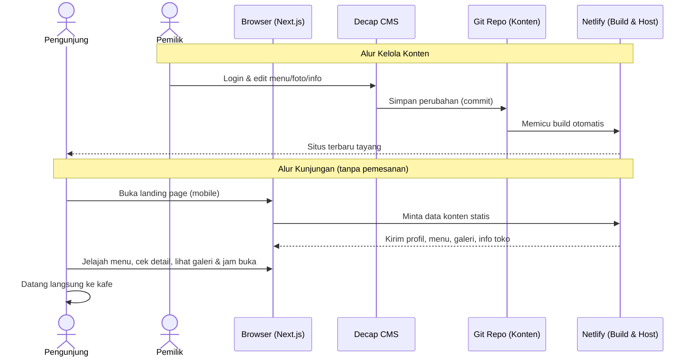
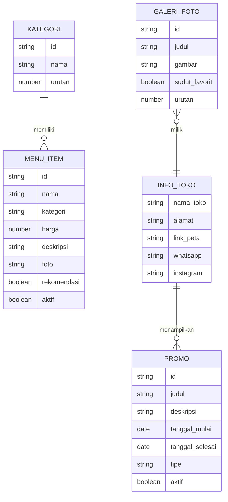

# PRD — Project Requirements Document

## 1. Overview

**Latar Belakang Masalah**
Coffee shop saat ini sering hanya mengandalkan Instagram atau spanduk fisik untuk memperkenalkan diri. Calon pengunjung — khususnya pelajar dan mahasiswa — harus menggulir banyak unggahan hanya untuk tahu menu dan harga, atau menebak-nebak lokasi dan jam bukanya. Akibatnya, calon pelanggan malas datang dan potensi kunjungan hilang.

**Tujuan Utama Aplikasi**
Membangun satu landing page resmi coffee shop yang:

- Menjadi wajah **branding visual** yang tampil kece dan konsisten di ponsel.
- Menyediakan **menu digital + harga** yang mudah dibaca, cepat dicari, dan selalu terbaru.
- Memperkenalkan **suasana kafe, lokasi, dan jam buka** agar calon pengunjung yakin untuk datang langsung.
- Membantu pemilik kafe **memperbarui konten sendiri** tanpa perlu bantuan teknis.
- Dioptimalkan untuk **mobile first**, karena mayoritas target (pelajar/mahasiswa) mengakses dari ponsel.

**Batas Lingkup (Out of Scope)**
Situs ini **bukan** platform pemesanan. Tidak ada keranjang, checkout, pembayaran, maupun pengiriman pesanan lewat WhatsApp. Menu digital bersifat informatif — pengunjung melihat menu dan harga, lalu datang langsung ke kafe. WhatsApp hanya dipakai sebagai kanal **kontak biasa** (tanya-tanya), bukan jalur pemesanan.

**Target Pengguna**
- **Pelajar & mahasiswa** yang mencari tempat nongkrong atau minum kopi cepat.
- **Pemilik kafe / staf** yang perlu memperbarui menu, foto, dan info toko secara mandiri.

---

## 2. Requirements

**Persyaratan Fungsional**
1. Halaman utama menampilkan profil singkat coffee shop dan daftar menu kopi & makanan lengkap dengan harga.
2. Menu dapat difilter per kategori dan dicari berdasarkan nama.
3. Setiap menu punya halaman detail dengan foto, deskripsi, serta pilihan ukuran/rasa sebagai informasi.
4. Galeri foto suasana kafe dapat dilihat dan diperbesar.
5. Informasi alamat, jam buka, kontak, dan tombol buka peta.
6. Menu dan harga selalu mencerminkan kondisi terbaru di kafe (bersifat informasi, bukan pemesanan).
7. Pemilik kafe dapat mengubah menu, harga, foto, dan info toko via CMS.
8. Perubahan konten memiliki alur pratinjau sebelum tayang.
9. Banner promo, label menu rekomendasi, dan info kegiatan tampil di halaman.

**Persyaratan Non-Fungsional**
- **Mobile first**: tata letak dioptimalkan untuk layar ponsel, lalu diperluas ke tablet & desktop.
- **Cepat**: halaman statis, waktu muat singkat, gambar teroptimasi.
- **Kece secara visual**: tipografi, warna, dan animasi halus yang konsisten dengan identitas brand kafe.
- **Mudah dikelola**: pemilik kafe tidak perlu menyentuh kode untuk memperbarui konten.
- **SEO & Shareable**: metadata dan gambaran tautan (Open Graph) bagus saat dibagikan di WhatsApp/Instagram.
- **Aksesibel**: kontras warna yang baik, target ketuk besar untuk jempol.

---

## 3. Core Features

### Fase 1 — Menu Digital *(prioritas tinggi)*
- **Kategori Menu** — Menu dipisah per kategori (kopi, non-kopi, camilan) supaya cepat menemukan yang dicari.
- **Daftar Menu & Harga** — Semua menu tampil dalam satu daftar rapi beserta harga terbarunya.
- **Detail Menu** — Ketuk satu menu untuk melihat foto, deskripsi singkat, dan keterangan pilihan ukuran atau rasa (hanya informasi, tanpa tombol pesan).
- **Cari Menu** — Ketik nama menu dan hasilnya langsung muncul tanpa perlu menggulir panjang.

### Fase 2 — Galeri Suasana & Info Kunjungan *(prioritas sedang)*
- **Galeri Foto Suasana** — Foto ruangan, meja, dan minuman ditampilkan dalam susunan galeri yang enak dilihat.
- **Sudut Favorit** — Kumpulan foto spot paling instagramable untuk membantu memilih tempat duduk.
- **Foto Layar Penuh** — Ketuk foto untuk melihatnya lebih besar dan jelas.
- **Alamat & Peta** — Lokasi coffee shop ditampilkan lengkap dengan tombol buka peta.
- **Jam Buka** — Jadwal buka dan tutup per hari terlihat jelas, termasuk penanda sedang buka atau tutup.
- **Kontak & Media Sosial** — Tombol cepat untuk menghubungi lewat WhatsApp atau membuka Instagram.

### Fase 3 — Profil & Sorotan *(prioritas rendah)*
- **Banner Promo** — Sorotan promo atau diskon hari ini tampil di bagian atas halaman.
- **Menu Rekomendasi** — Daftar menu andalan yang ditandai khusus agar mudah dipilih pendatang baru.
- **Info Kegiatan** — Pengumuman acara atau live music ditampilkan dengan tanggalnya.

---

## 4. User Flow

**A. Pengunjung (pelajar/mahasiswa)**
1. Membuka tautan landing page coffee shop dari Instagram/WhatsApp (di ponsel).
2. Halaman utama langsung menampilkan **profil singkat kafe**, **banner promo** (bila ada), dan daftar menu.
3. Pengunjung memilih **kategori** (kopi/non-kopi/camilan) atau mengetik di **kolom cari**.
4. Mengetuk salah satu menu → muncul **halaman detail** (foto, deskripsi, ukuran, rasa, harga) sebagai informasi.
5. Pengunjung menelusuri **galeri suasana**, melihat **sudut favorit**, lalu mengecek **jam buka & alamat** (buka peta) sebelum datang langsung ke kafe.
6. Bila ingin bertanya, pengunjung menekan tombol **kontak WhatsApp/Instagram** — bukan untuk mengirim pesanan.

**B. Pemilik Kafe**
1. Masuk ke panel admin (Decap CMS) lewat browser.
2. Memilih bagian yang mau diubah: **Menu**, **Galeri**, atau **Info Toko**.
3. Mengedit/menambah data lewat formulir sederhana, mengunggah foto bila perlu.
4. Memakai **pratinjau (preview)** untuk memastikan tampilan sudah benar.
5. Menyimpan publikasi → perubahan tersimpan sebagai konten baru, situs di-deploy otomatis lewat Netlify, dan pengunjung langsung melihat versi terbaru.

---

## 5. Architecture

**Gambaran Sistem**
Aplikasi ini dibangun dengan pendekatan **JAMstack** (statis + CMS berbasis Git) agar cepat, murah, dan mudah dikelola:

- **Frontend**: Next.js (React) dengan render statis (SSG/ISR) → halaman ringan & SEO-friendly.
- **Konten / "Backend"**: Decap CMS (berbasis Git) mengelola menu, galeri, info toko, promo sebagai file konten (Markdown/JSON). Tidak butuh server backend khusus.
- **Integrasi eksternal**: WhatsApp Click-to-Chat (`wa.me`) dan Instagram hanya sebagai **kanal kontak**, Google Maps embed untuk peta. Tidak ada integrasi pemesanan/pembayaran.
- **Deployment**: Netlify (hosting statis + build otomatis tiap perubahan konten + Netlify Identity/Git Gateway untuk akses CMS).

---

## 6. Database Schema

Karena memakai pendekatan JAMstack dengan Decap CMS, "database" di sini berupa **kumpulan file konten terstruktur** yang disimpan di Git dan dibaca oleh Next.js saat build. Struktur di bawah menggambarkan koleksi/entitas beserta field utamanya.

**Koleksi `menu_item`** — data setiap menu.
- `id` (string) — identitas unik menu.
- `nama` (string) — nama menu, mis. "Es Kopi Susu".
- `kategori` (string) — kopi / non-kopi / camilan.
- `harga` (number) — harga dasar (Rupiah).
- `deskripsi` (string) — penjelasan singkat menu.
- `foto` (gambar) — foto utama menu.
- `ukuran` (array string) — pilihan ukuran (Regular, Large) — opsional.
- `rasa` (array string) — pilihan rasa/varian — opsional.
- `rekomendasi` (boolean) — penanda menu andalan (Fase 3).
- `aktif` (boolean) — tampil atau tidak di halaman.

**Koleksi `kategori`** — daftar kategori menu.
- `id` (string) — identitas kategori.
- `nama` (string) — nama kategori.
- `urutan` (number) — urutan tampil.

**Koleksi `galeri_foto`** — foto suasana kafe.
- `id` (string) — identitas foto.
- `judul` (string) — judul/keterangan foto.
- `gambar` (gambar) — berkas foto.
- `sudut_favorit` (boolean) — tandai sebagai spot instagramable.
- `urutan` (number) — urutan tampil.

**Koleksi `info_toko`** — informasi umum coffee shop (satu entri).
- `nama_toko` (string) — nama coffee shop.
- `alamat` (string) — alamat lengkap.
- `link_peta` (string) — URL Google Maps.
- `whatsapp` (string) — nomor WhatsApp untuk kontak/tanya-jawab (bukan tujuan pesanan).
- `instagram` (string) — tautan Instagram.
- `jam_buka` (array objek) — daftar hari + jam buka/tutup.

**Koleksi `promo`** — banner promo & info kegiatan (Fase 3).
- `id` (string) — identitas promo.
- `judul` (string) — judul promo/kegiatan.
- `deskripsi` (string) — keterangan singkat.
- `tanggal_mulai` (date) — tanggal mulai tayang.
- `tanggal_selesai` (date) — tanggal berakhir.
- `gambar` (gambar) — gambar banner — opsional.
- `tipe` (string) — promo / kegiatan.
- `aktif` (boolean) — tampil atau tidak.

Tidak ada koleksi pesanan, keranjang, atau transaksi — situs hanya membaca konten.

---

## 7. Tech Stack

**7.1 Ringkasan Versi (Baseline Proyek)**

Angka di bawah adalah versi yang **dipatok saat inisialisasi proyek**. Semua versi memakai caret (`^`) agar patch/minor security update tetap masuk, kecuali disebut lain.

| Lapisan | Teknologi | Versi baseline | Keterangan |
| --- | --- | --- | --- |
| Runtime | Node.js | **22.x LTS** (minimum 20.9) | syarat minimum Next.js 15 |
| Package manager | npm | **10.x** | commit `package-lock.json`, CI pakai `npm ci` |
| Bahasa | TypeScript | **5.x** (`strict: true`) | seluruh komponen & file konten bertipe |
| Framework UI | Next.js | **15.x** — App Router | SSG untuk semua halaman publik |
| Library UI | React | **19.x** | versi yang dibutuhkan Next.js 15 |
| Styling | Tailwind CSS | **4.x** | konfigurasi tema via CSS (`@theme`), bukan `tailwind.config.js` |
| Komponen | shadcn/ui | **CLI terbaru (kompatibel Tailwind v4)** | komponen di-*copy-in* ke `components/ui`, bukan dependency npm |
| Animasi | Framer Motion (`motion`) | **12.x** — opsional | hanya untuk transisi halus, tidak wajib |
| Ikon | lucide-react | **0.5xx** (mengikuti shadcn/ui) | ikon menu, tombol kontak, peta |
| CMS | Decap CMS | **3.x** | dimuat lewat `/admin/index.html` + `config.yml` |
| Auth Admin | Netlify Identity + Git Gateway | **dikelola Netlify** | tidak ada versi npm yang perlu dipatok |
| Hosting & Build | Netlify | **build image terbaru** | set `NODE_VERSION=22` di environment Netlify |
| Peta | Google Maps Embed | **iframe `output=embed`** | tanpa API key, tanpa library tambahan |
| Lint & Format | ESLint **9.x** + Prettier **3.x** | bawaan `create-next-app` | aturan `next/core-web-vitals` |

> Catatan: angka minor di atas boleh bergeser ke rilis stabil terbaru saat `npm install` pertama. Yang **tidak boleh** bergeser adalah major version, karena Tailwind v4 dan React 19 mengubah cara konfigurasi.

**7.2 Frontend**
- **Next.js 15.x (React 19)** — framework utama dengan **App Router**. Semua halaman publik (`/`, `/menu/[slug]`, `/galeri`) dirender statis saat build sehingga cepat dibuka, ramah SEO, dan memakai `next/image` untuk optimasi gambar otomatis. *(sesuai pilihan React dari user, dikembangkan ke Next.js)*
- **Mode render**: default `output: 'export'` (statis penuh) supaya cocok dengan Netlify + Decap CMS. ISR hanya diaktifkan bila nanti pindah ke Next.js runtime di Netlify — kedua opsi tidak mengubah struktur folder.
- **Tailwind CSS 4.x** — menyusun tata letak **mobile first** (breakpoint dasar = ponsel). Token warna, radius, dan tipografi brand didefinisikan sekali di `globals.css`.
- **shadcn/ui** — komponen siap pakai (kartu menu, dialog foto, tombol kontak) yang dipasang per-komponen lewat CLI, sehingga tidak menambah berat bundle untuk komponen yang tidak dipakai.
- **Framer Motion 12.x** *(opsional)* — animasi masuk kartu menu dan transisi lightbox galeri.

**7.3 Manajemen Konten**
- **Decap CMS 3.x** — CMS berbasis Git yang langsung terhubung ke Netlify, dipakai pemilik kafe untuk mengubah menu, galeri, info toko, dan promo tanpa bantuan teknis. Diakses di `/admin`.
- Konten disimpan sebagai file **Markdown + frontmatter** (menu, galeri, promo) dan **JSON/YAML** (`info_toko`) di repositori Git, sesuai koleksi di Bagian 6.

**7.4 "Backend" & Data**
- **Tanpa server khusus (AI pick)** — tidak ada framework backend (Express/Nest/Fastify), tidak ada API route bisnis. Seluruh konten dihasilkan saat build: tanpa database, tanpa transaksi.
- **Tanpa state pesanan** — tidak ada keranjang, checkout, maupun `localStorage` untuk riwayat pesanan.
- **Integrasi pihak ketiga**: hanya **WhatsApp Click-to-Chat** (`wa.me`, kanal kontak) dan **Google Maps Embed** (peta). Tidak ada payment gateway.
- **Database opsional (AI pick)**: bila nanti butuh fitur dinamis (mis. analitik kunjungan), bisa ditambah **SQLite + Drizzle ORM** (atau Netlify Blobs) tanpa mengubah struktur utama. *(Fitur pemesanan tetap di luar lingkup.)*

**7.5 Autentikasi Admin**
- **Netlify Identity + Git Gateway** — membatasi akses panel Decap CMS hanya untuk pemilik/staf kafe. Tidak ada halaman login yang perlu dibangun sendiri. *(Alternatif bila butuh login mandiri: Better Auth.)*

**7.6 Deployment & Hosting**
- **Netlify** — hosting statis, build otomatis di setiap perubahan konten, domain gratis, dan HTTPS bawaan. Build command `npm run build`, publish directory menyesuaikan output Next.js; `NODE_VERSION` dipatok ke 22.

**7.7 Kebijakan Versi & Upgrade**
- Semua dependency dipatok dengan caret; `package-lock.json` **wajib** di-commit agar build Netlify deterministik.
- Upgrade major (mis. Tailwind 5, Next.js 16) dilakukan manual dan harus lewat PR terpisah dengan uji ulang tampilan mobile.
- Fitur yang **tidak** dipakai dan tidak perlu dipasang: Prisma/PostgreSQL, NextAuth, Stripe/Midtrans, Supabase, library state management (Redux/Zustand) — situs ini tidak menyimpan state pesanan.